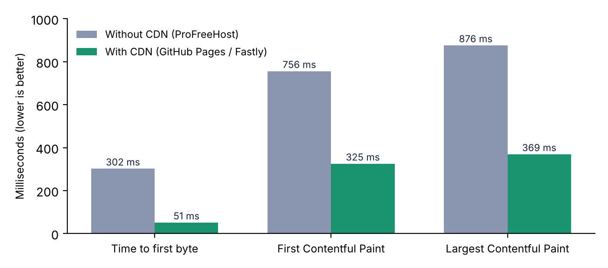
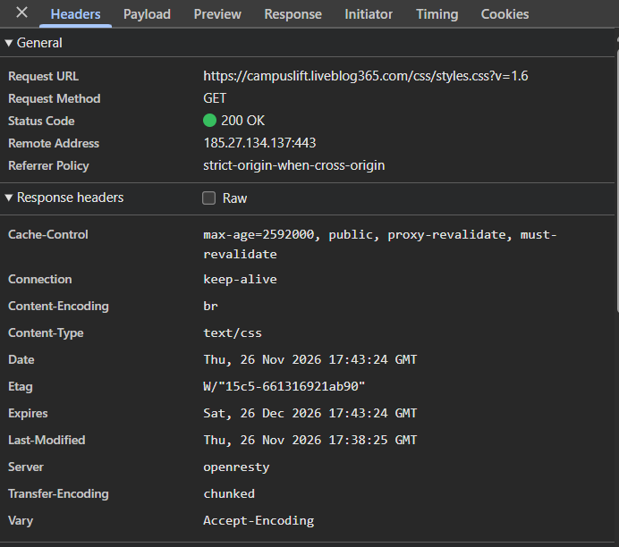
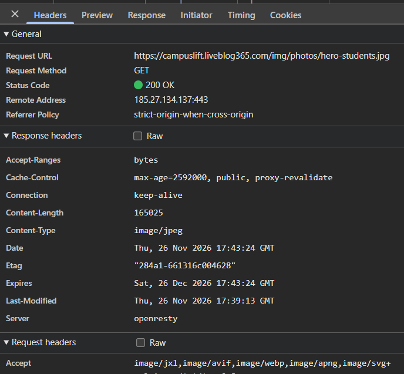
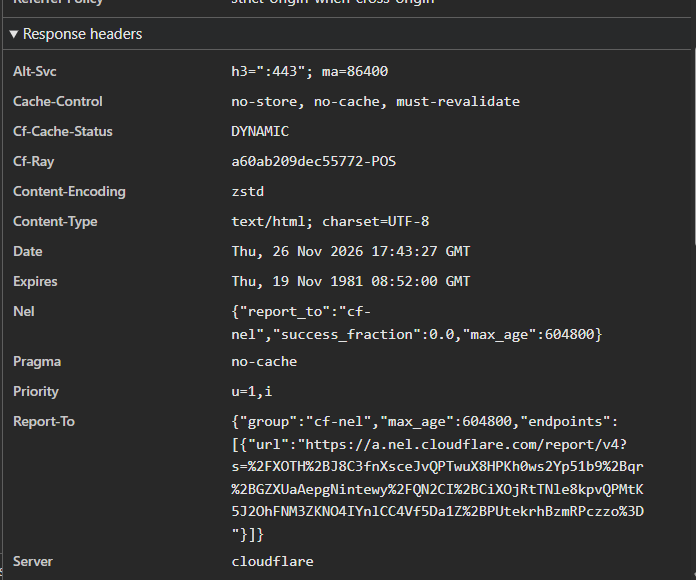
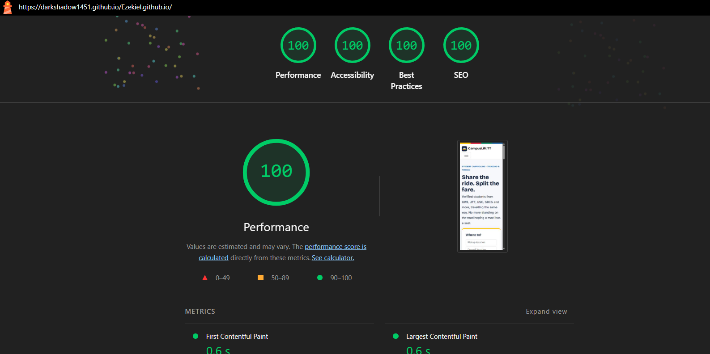
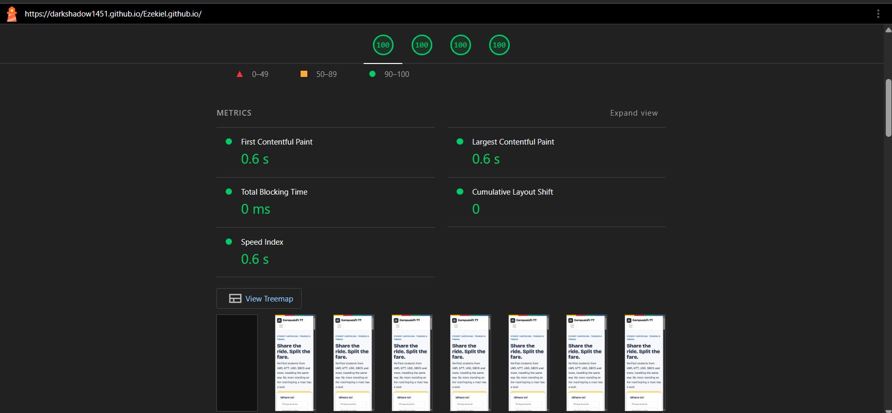
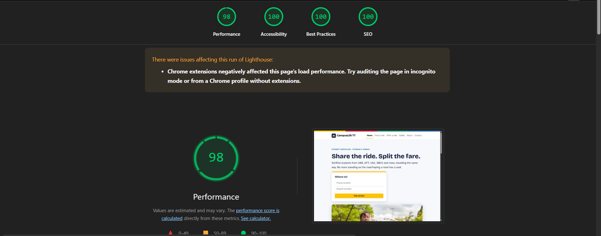
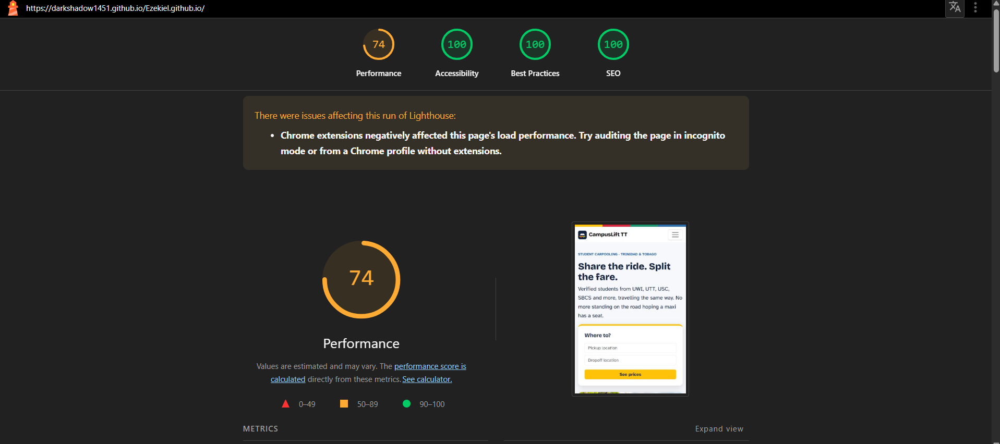

# CampusLift TT

My CPTR331 Assignment 5. It's a 6-page carpool website for students in Trinidad and Tobago.

- With CDN (GitHub Pages, uses Fastly): https://campuslift.github.io/Ezekiel.github.io/
- Without CDN (ProFreeHost): https://campuslift.liveblog365.com/

## About the site

- Pages: Home, Find a Ride, Offer a Ride, Safety, About, Contact
- Built with HTML, CSS, JavaScript, Bootstrap 5.3.3 and Google Fonts
- Folders: `css`, `js`, `img`, `media` (empty for now)
- JavaScript: fare calculator, contact form check (form sends to Formspree), backup drawings if a photo is missing
- Speed: lazy loaded images, `defer` on scripts, image width and height set
- Accessibility and SEO: semantic tags, alt text, ARIA labels, skip link, focus outline, page titles and descriptions, canonical links, JSON-LD, `robots.txt`, `sitemap.xml`

## CDN and caching

My images, CSS and JS are on GitHub Pages, which uses the Fastly CDN. Bootstrap and the fonts come from CDNs too.

I used ProFreeHost to compare without a CDN. Its CSS and image headers I checked show `openresty` and no CDN headers. The HTML does show Cloudflare, which I think the host added.

I added `?v=1.6` to my CSS and JS links. When I change a file, I change the number so the browser gets the new one.

My `_headers` file tells CSS, JS and images to cache for 1 year, and HTML to check for updates every time. GitHub Pages and ProFreeHost both ignore it, so **I couldn't show it working live**. ProFreeHost caches CSS and images for 30 days.

## Speed test results

I tested both sites on 26 November 2026 using DebugBear (desktop, US East, same settings). I ran the tests when my GitHub site was at `darkshadow1451.github.io/Ezekiel.github.io/`, before the address changed. That is why the screenshots show the old address.

| Test | Without CDN | With CDN |
| --- | --- | --- |
| Performance score | 99 | 100 |
| Time to first byte | 302 ms | 51 ms |
| First Contentful Paint | 756 ms | 325 ms |
| Largest Contentful Paint | 876 ms | 369 ms |
| Speed Index | 0.7 s | 0.3 s |
| Total Blocking Time | 0 ms | 0 ms |
| Layout Shift (CLS) | 0.003 | 0.002 |
| Page size | 529 KB | 389 KB |

The CDN version was faster. It started responding 251 ms sooner and showed the main content in less than half the time. I think a closer server helped, but the CDN might not be the only reason.

The test wasn't perfectly fair:

- The main image was 161 KB on ProFreeHost but 103 KB on GitHub Pages.
- GitHub Pages had version 1.5 files and ProFreeHost had 1.6.
- ProFreeHost still had Cloudflare on the HTML.
- I only have one DebugBear result for each site.
- The two hosts may also have different servers.

## Screenshots

### Without CDN headers

CSS file:

Image file:

HTML page:

### Lighthouse (GitHub Pages)

| | Performance | Accessibility | Best Practices | SEO |
| --- | --- | --- | --- | --- |
| Mobile | 100 | 100 | 100 | 100 |
| Desktop | 98 | 100 | 100 | 100 |

Mobile:

Desktop (Lighthouse warned that Chrome extensions affected this run):

I got 74 on an earlier mobile run. Lighthouse said Chrome extensions affected it. A later run got 100.

Accessibility:

